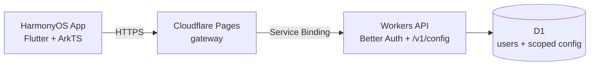

# Clash Harmony

Minimal HarmonyOS edition: sign in, fetch admin-managed Mihomo config from Cloudflare, auto-select a node, connect. Full product guide: **[README_SIMPLE.md](README_SIMPLE.md)** (简体中文).

Upstream FlClash docs are collapsed here for reference only: [简体中文](README_zh_CN.md) · [releases / desktop features](../../actions) apply to the full multi-platform client, not this fork’s daily path.

## Architecture

- **App** (`lib/`, `ohos/`): login, cached config, connect/disconnect, auto route selection.
- **Pages gateway** (`backend/gateway/`): public `*.pages.dev` entry, security headers, path allowlist.
- **Worker** (`backend/src/`): auth, per-user config resolution, rate limits, audit log.
- **D1**: Better Auth tables + `proxy_config` (default / per-user / per-group).

## Secrets & deploy (summary)

1. Copy `backend/wrangler.local.jsonc.example` → local `backend/wrangler.local.jsonc` (gitignored): set your **D1 `database_id`**, optional `workers_dev`, and `AUTH_ORIGIN`.
2. `BETTER_AUTH_SECRET` via `wrangler secret put` (≥ 32 random chars).
3. Apply migrations: `npx wrangler d1 migrations apply clash-harmony-auth --remote`.
4. Accounts: `npm run account -- USER --remote --print-password` (password shown once; not written to disk by default).
5. Config: private JSON `{"SUBSCRIPTION_URL":"..."}` → `npm run config -- /path/secrets.json --remote` (default). Per-user: `--scope=user --scope-key=<userId>`; per-group: `--scope=group --scope-key=<group>`.

Details: [backend/README.md](backend/README.md).

## Build & CI

GitHub Actions workflow **Clash Harmony** (`.github/workflows/harmony-simple.yml`): backend tests, Flutter analyze/test, unsigned HAP on app changes. Uses pinned gitcode SHAs in [`.github/harmony-pinned-shas.env`](.github/harmony-pinned-shas.env).

## Repo layout note

Platform trees (`android/`, `windows/`, `macos/`, `linux/`) remain from upstream FlClash for shared code and CI parity; the Harmony **simple** product path uses `ohos/` + slim dashboard only.

Based on [tljk/FlClash-ohos](https://github.com/tljk/FlClash-ohos), GPL-3.0.
