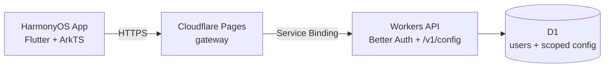

# 小猫AI代理

Minimal HarmonyOS edition: sign in, fetch admin-managed Mihomo config from Cloudflare, auto-select a node, connect. Full product guide: **[README_SIMPLE.md](README_SIMPLE.md)** (简体中文).

Upstream FlClash docs are collapsed here for reference only: [简体中文](README_zh_CN.md) · [releases / desktop features](../../actions) apply to the full multi-platform client, not this fork’s daily path.

## Architecture

- **App** (`lib/`, `ohos/`): login, cached config, connect/disconnect, auto route selection.
- **Pages gateway** (`backend/gateway/`): public HTTPS entry (your `*.pages.dev` or custom domain), security headers, path allowlist.
- **Worker** (`backend/src/`): auth, per-user config resolution, rate limits, audit log.
- **D1**: Better Auth tables + `proxy_config` (default / per-user / per-group).

## Required configuration (names only)

No real API URLs, D1 IDs, subscriptions, or credentials belong in git. Use local/gitignored files and platform secrets.

### GitHub Actions (repository **Variables** / **Secrets**)

| Name | Kind | Purpose |
|------|------|---------|
| `CLASH_HARMONY_API_URL` | Variable (optional) | Public HTTPS origin baked into release HAP via `env.json` at build time. If unset, CI uses `https://auth.example.com`. |

### Cloudflare Worker (`backend/`)

| Name | Kind | Purpose |
|------|------|---------|
| `BETTER_AUTH_SECRET` | Secret (`wrangler secret put`) | Better Auth signing key (≥ 32 random chars). |
| `AUTH_ORIGIN` | Var (in gitignored `wrangler.local.jsonc` or dashboard) | Public HTTPS origin of the auth API (must match what clients use). |
| D1 `database_id` | Resource binding | In gitignored `wrangler.local.jsonc` only; committed `wrangler.jsonc` uses an all-zero placeholder. |

### Cloudflare Pages gateway (`backend/gateway/`)

| Name | Kind | Purpose |
|------|------|---------|
| Pages project name | Dashboard | Your gateway project (Service Binding to the Worker above). |
| `API` service binding | `wrangler.jsonc` | Binds to the Worker service name you deploy. |

### HarmonyOS app build (local / CI)

| Name | Kind | Purpose |
|------|------|---------|
| `CLASH_HARMONY_API_URL` | `dart-define` / `env.json` | Copy [`env.json.example`](env.json.example) → gitignored `env.json` for `dart setup.dart` / Flutter builds. |

### Operator-only files (never commit)

| File | Purpose |
|------|---------|
| `backend/wrangler.local.jsonc` | Real `database_id`, `AUTH_ORIGIN`, optional `workers_dev`. Template: [`backend/wrangler.local.jsonc.example`](backend/wrangler.local.jsonc.example). |
| `backend/secrets.json` or any `*.secrets.json` | `SUBSCRIPTION_URL` for `npm run config`. Template: [`backend/secrets.example.json`](backend/secrets.example.json). |
| `env.json` | Flutter `CLASH_HARMONY_API_URL` for packaged builds. |

Deploy steps: [backend/README.md](backend/README.md).

## Build & CI

GitHub Actions workflow **小猫AI代理** (`.github/workflows/harmony-simple.yml`): secret pattern scan, backend tests, Flutter analyze/test, unsigned HAP on app changes. Uses pinned gitcode SHAs in [`.github/harmony-pinned-shas.env`](.github/harmony-pinned-shas.env).

## Repo layout note

Platform trees (`android/`, `windows/`, `macos/`, `linux/`) remain from upstream FlClash for shared code and CI parity; the Harmony **simple** product path uses `ohos/` + slim dashboard only.

Based on [tljk/FlClash-ohos](https://github.com/tljk/FlClash-ohos), GPL-3.0.

## Naming and upgrade compatibility

The app display name is **小猫AI代理** in both supported languages (Chinese and English); portable artifact filenames use `xiaomao-ai-proxy`. The GitHub repository slug is managed separately in repository settings. Existing repository links remain on the verified current URL until that rename is completed.

Package IDs, signing identity, storage paths, launch/service IDs, URL schemes and the internal `fl_clash` / `FlClash` identifiers stay stable so existing configuration and update compatibility are preserved. Upstream project names and credits remain attribution. Already installed apps keep their old label until a new build is installed. This rename does not deploy a backend or restart a canceled package build.
